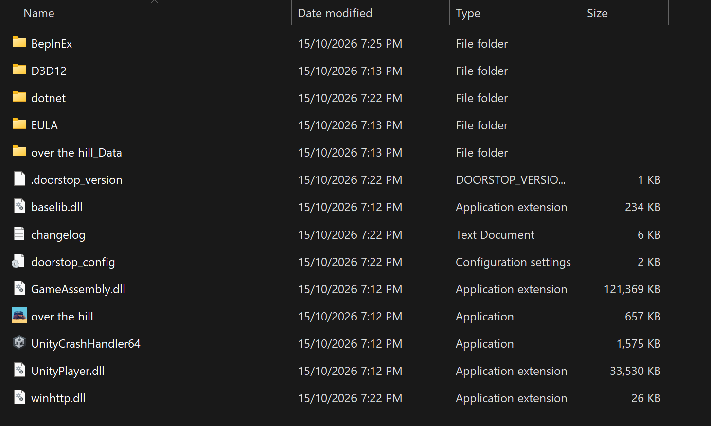

# Over the Hill Unlimited

A [BepInEx](https://github.com/BepInEx/BepInEx) mod that raises the 4-player co-op cap in
[Over the Hill](https://store.steampowered.com/app/2929250/), inspired by [PEAK Unlimited](https://github.com/glarmer/PEAK-Unlimited).

> **Status: early and experimental.** A modded host can create a server for more than 4 players, and the game's
> networked player state has room for 16. That's been verified hosting solo. Sessions with real players haven't
> been tested yet.

**Download:** [Releases](https://github.com/t04glovern/over-the-hill-unlimited/releases). See [Installation](#installation).

## Status

| Piece | State |
|---|---|
| Host can pick up to 16 in Create Server, Max Players | Verified |
| Photon Fusion room uses that size (`1/8 players`) | Verified |
| A 5th player can join | Verified |
| Networked player list (order, colours, names) holds 16 players | Verified solo |
| Map pins, portable winch anchors and camp tents hold 16 players | Pins verified solo; anchors and tents untested |
| Map and player list UI refresh when the expanded data changes | Verified solo for map pins |
| Lobby spawn points and meteorite spawns with 5+ players | Both errored in the first 5-player session; padded in 0.1.1, 5-player retest needed |
| Pause menu, map, compass and car health UI | Working, but they only show the first 4 players |
| Car repair and tool selection menus with 5+ players | Untested, may break (they size their UI by player count) |
| Native Linux (not Proton) | Joining crashed in 0.1.0; fixed in 0.1.1, untested |
| Players without the mod in a modded session | Unknown |

## Installation

Everyone in the session needs to do this, not just the host.

### Windows

1. **Open your game folder.** In Steam, right-click Over the Hill, then Manage, then Browse local files.
2. **Install BepInEx.** Download
   [BepInEx-Unity.IL2CPP-win-x64-6.0.0-be.788+5b766a3.zip](https://builds.bepinex.dev/projects/bepinex_be/788/BepInEx-Unity.IL2CPP-win-x64-6.0.0-be.788%2B5b766a3.zip)
   and extract it into the game folder, so that `winhttp.dll` sits next to `over the hill.exe`. Your game folder
   should then look like this:

   

3. **Run the game once**, wait for the main menu, then quit. The first launch takes a minute or two longer than usual.
4. **Install the mod.** Download `OverTheHillUnlimited-<version>.zip` from
   [Releases](https://github.com/t04glovern/over-the-hill-unlimited/releases) and extract it into the game folder.
   You should end up with `BepInEx\plugins\OverTheHillUnlimited\OverTheHillUnlimited.dll`.
5. **Play.** The host picks a Max Players above 4 under Create Server.

To uninstall, delete `winhttp.dll` from the game folder.

### Linux and Steam Deck

Over the Hill has a native Linux version, and that's what Steam installs by default. The mod is only built and tested
against the Windows version, so on Linux you run the Windows version through Proton. On a Steam Deck, do this in
Desktop Mode. These steps haven't been fully tested on Linux yet.

1. **Switch to the Windows version.** In Steam, right-click Over the Hill, then Properties, then Compatibility. Tick
   "Force the use of a specific Steam Play compatibility tool", pick Proton Experimental, and let Steam finish
   updating the game.
2. **Open your game folder.** In Steam, right-click Over the Hill, then Manage, then Browse local files.
   It's usually `~/.local/share/Steam/steamapps/common/over the hill`, and it should now contain `over the hill.exe`.
3. **Install BepInEx.** Download the
   [same BepInEx zip](https://builds.bepinex.dev/projects/bepinex_be/788/BepInEx-Unity.IL2CPP-win-x64-6.0.0-be.788%2B5b766a3.zip)
   and extract it into the game folder, so that `winhttp.dll` sits next to `over the hill.exe`, like the screenshot above.
4. **Tell Proton to load BepInEx.** In Steam, right-click Over the Hill, then Properties. Under General, set
   Launch Options to:

   ```
   WINEDLLOVERRIDES="winhttp=n,b" %command%
   ```

5. **Run the game once**, wait for the main menu, then quit. The first launch takes a few minutes longer than usual.
6. **Install the mod.** Download `OverTheHillUnlimited-<version>.zip` from
   [Releases](https://github.com/t04glovern/over-the-hill-unlimited/releases) and extract it into the game folder.
   You should end up with `BepInEx/plugins/OverTheHillUnlimited/OverTheHillUnlimited.dll`.
7. **Play.** The host picks a Max Players above 4 under Create Server.

To uninstall, clear the launch option, then untick the compatibility option to go back to the native version.

## Configuration

`BepInEx/config/OverTheHillUnlimited.cfg` is created on first launch.

| Setting | Default | Description |
|---|---|---|
| `General.MaxPlayers` | `8` | Highest option in the Max Players menu, 1 to 16. |
| `General.ExpandPlayerSlots` | `true` | Master switch. Turn it off to play vanilla with people who don't have the mod. |
| `Debug.VerboseLogging` | `false` | Log the session size and player list as players join and leave. Useful for testing. |

## How it works

Over the Hill is a Unity 6 IL2CPP game that uses Photon Fusion 2 in host mode. Two separate things cap it at 4 players,
and fixing the second one exposes a third.

### 1. Session size

```
Create Server menu ──► GameSetupContext.MaxPlayers ──X   game always passes 4   ──► StartGameArgs.PlayerCount ──► Fusion room
 options "2" "3" "4"                                                                                                    max 4
```

- `CreateServerMenuPatch` appends `5..MaxPlayers` to the menu's options. The game parses the chosen option into
  `GameSetupContext.MaxPlayers` itself.
- The game ignores that value when it starts Fusion. It always passes `StartGameArgs.PlayerCount = 4` and enforces
  smaller choices on its own. `SessionSizePatches` remembers the menu value in `OverlandNetworkRunner.StartGame`.
  It then writes that value into the copy of `StartGameArgs` that Fusion's `StartGameModeCloud` async method keeps in
  its state machine. That happens on the state machine's first `MoveNext()`, before the Photon room is created from it.
  (Patching `NetworkRunner.StartGame(StartGameArgs)` directly works on Windows but crashes on native Linux; see
  [Gotchas](#gotchas).)
- It also raises Fusion's default player count, `NetworkProjectConfig.Simulation.PlayerCount` (shipped as 4), to 16
  on every modded peer.

### 2. Fixed-size networked state

Fusion stores each `NetworkBehaviour`'s `[Networked]` properties in a fixed block of 32-bit words, and replicates that
block from the host to every client. Networked collections have a compile-time size (`[Capacity(n)]`), and Fusion's weaver
bakes their offsets into the property getters. The game sizes its per-player collections for 4 players:

| Behaviour | Per-player collections | Vanilla words | Modded words |
|---|---|---|---|
| `OverlandSessionPlayers` | player order, colours, names, busy state, dev team and supporter edition flags | 390 | 1250 |
| `MapNetworkManager` | map pinpoint positions and objects, portable winch anchors | 107 | 354 |
| `CampManager` | spawned tents | 10 | 26 |

The mod leaves the vanilla words alone. It appends a 16-slot copy of each collection after them:

```
OverlandSessionPlayers state block (replicated by Fusion)
┌───────────────────────────────┬──────────────────────────────────────────────────┐
│ vanilla: 390 words            │ appended by the mod: 860 words                   │
│ 4-slot collections (unused)   │ 16-slot player order, colours, names, flags ...  │
└───────────────────────────────┴──────────────────────────────────────────────────┘
```

- Fusion asks `NetworkBehaviourUtils.GetWordCount(behaviour)` how big each block should be. A postfix adds the extra
  words for these three behaviours.
- A postfix on each collection's property getter returns a collection built over the appended words instead. It uses
  the same constructor as the woven getter, with a different pointer and capacity. Game code that goes through the
  getters therefore sees 16 slots.
- Fusion replicates the whole block, so the appended slots should sync like any other networked state. This is the
  part the 2-player test still needs to confirm.
- Fusion's `ChangeDetector` only compares each property's *vanilla* word range, so on its own it never sees changes to
  the appended copies. `MapNetworkManager` and `OverlandSessionPlayers` refresh their UI from it in `Render()`, which made
  map pins appear only after reopening the map. To fix that, a prefix on their `Render()` runs on the host first. It writes
  a hash of each appended collection into the last word of the vanilla range it replaces, which is otherwise unused.
  When the real data changes the hash changes, so the property reads as changed. The hash also replicates to clients, so
  their change detectors fire too. `CampManager` doesn't use a `ChangeDetector`.

[`Networking/ExpandedState.cs`](src/OverTheHillUnlimited/Networking/ExpandedState.cs) holds the layout maths, builds the
collections and signals changes. Each behaviour has a small patch class that declares its collections and where their
vanilla versions live.

### 3. UI built for 4 players

Some UIs keep one element per player but loop over the whole player list. With 16 slots, the pause menu and the map threw
`ArgumentOutOfRangeException`, which broke pause menu navigation. `PlayerListUiPatches` makes the player list report only
its first 4 slots while those UI methods run. The compass and car health UI get the same treatment as a precaution. They
all work as before, but players 5 and up don't appear in them yet.

### 4. Game data sized for 4 players

Some game data has one entry per player, and the code indexes it by player count or slot. With 5 players, it reads
past the end. `PerPlayerTablePatches` pads each table up to 16 entries the first time the game reads it:

- `MeteoritesSpawnConfig.SpawnableMeteoritesByPlayersCount`, indexed by `ActivePlayers.Count()`, gets copies of
  its 4-player entry.
- `Lobby.spawnPoints`, indexed by the player's slot, gets clones of the 4 vanilla spawn points, in extra rows 8 m in
  front of them. Their placeholder car previews are hidden.

### Why everyone needs the mod

PEAK uses Photon PUN, where raising the room size on the host is enough. Here, the appended words change the size of
replicated state, so every peer has to append exactly the same layout. That's why the slot count is a fixed 16 rather than
following `MaxPlayers`. A player without the mod, or with `ExpandPlayerSlots` off, is not expected to work in a modded
host's session.

### Safety

- The mod checks each behaviour's vanilla word count at runtime. If a game update changes it, the mod logs an error and
  leaves that behaviour at 4 slots, rather than writing to a layout it doesn't understand.
- If any patch fails to apply, for example because a game update renamed a method, the mod removes all of its patches
  and logs an error. A half-patched game is worse than a vanilla one.
- `ExpandPlayerSlots = false` turns every patch off.

## Development

### Prerequisites

- .NET SDK 8 or newer. The project targets `net6.0`, the runtime BepInEx 6 ships with.
- Over the Hill with BepInEx installed and launched once, so `BepInEx/interop/` exists.

### Build

```
dotnet build
```

References come straight from the game's `BepInEx/core` and `BepInEx/interop` folders, so the only package is the
.NET reference pack. `nuget.config` adds nuget.org for it. The build copies the DLL and PDB into
`BepInEx/plugins/OverTheHillUnlimited/`. The copy fails with a warning while the game is running, because the DLL is
locked. If the game isn't in the default Steam location, copy `Config.Build.user.props.template` to
`Config.Build.user.props` and set `GameDir`.

### Project layout

```
src/OverTheHillUnlimited/
  Plugin.cs                           entry point, config, patch registration
  Networking/ExpandedState.cs         appended state layout and collection construction
  Patches/
    CreateServerMenuPatch.cs          Max Players menu options
    SessionSizePatches.cs             Fusion session size
    SessionPlayersCapacityPatches.cs  OverlandSessionPlayers
    MapNetworkCapacityPatches.cs      MapNetworkManager
    CampCapacityPatches.cs            CampManager
    PerPlayerTablePatches.cs          game data with one entry per player
    PlayerListUiPatches.cs            UIs built for 4 players
    SessionDiagnosticsPatches.cs      VerboseLogging output
tools/
  Build-Release.ps1                   build and package a release zip
  Dump-GameCode.ps1                   dump the game's code with Cpp2IL
```

### Releasing

1. Bump `<Version>` in `src/OverTheHillUnlimited/OverTheHillUnlimited.csproj`. The plugin's BepInEx version is generated
   from it.
2. Run `powershell -File tools/Build-Release.ps1`. It builds Release and writes
   `artifacts/OverTheHillUnlimited-<version>.zip`, laid out to extract straight into the game folder.
3. Commit and push, then publish the zip:
   `gh release create v<version> artifacts/OverTheHillUnlimited-<version>.zip --title "v<version>" --notes "..."`

### Reading the game's code

IL2CPP compiles the game to native code, so there's no `Assembly-CSharp.dll` with method bodies to decompile.
`tools/Dump-GameCode.ps1` runs [Cpp2IL](https://github.com/SamboyCoding/Cpp2IL) and writes C# stubs to
`.dump/diffable/DiffableCs/`, which is gitignored; don't commit game code. The stubs have no method bodies. They do have
every type and field, Fusion's weaving attributes (`[Capacity]`, `[NetworkedWeaved(offset, words)]`,
`[NetworkBehaviourWeaved(words)]`), and `[Calls]`/`[CalledBy]` cross-references. That's how the patch targets were found.
Re-run it after game updates, and check that the vanilla word counts in the patch classes still match.

Logs:
- The mod's output is in `BepInEx/LogOutput.log`.
- Exceptions thrown by game code are in `%USERPROFILE%\AppData\LocalLow\Funselektor\over the hill\Player.log`.
  Under Proton, that's
  `~/.local/share/Steam/steamapps/compatdata/2929250/pfx/drive_c/users/steamuser/AppData/LocalLow/Funselektor/over the hill/Player.log`.

### Gotchas

- The interop assemblies expose private members as public, under their original names. For example,
  `ContextUICreateServer.maxPlayersOptionsRange`.
- Don't patch `NetworkBehaviour.DynamicWordCount`. IL2CPP deduplicated it, so its native code is shared with
  unrelated methods. Patch `NetworkBehaviourUtils.GetWordCount` instead.
- The interop wrapper misreports `StartGameArgs.PlayerCount` (a `Nullable<int>`) as 0, so `SessionSizePatches` reads
  the raw struct.
- Don't patch methods that take a large struct by value, such as `NetworkRunner.StartGame(StartGameArgs)`. On Windows
  (Microsoft x64) the struct arrives as a pointer to a copy. On Linux (System V) it's copied onto the stack, which
  Il2CppInterop's trampolines don't handle, so native Linux crashes with a SIGSEGV. Patch somewhere that holds the struct
  in a field or behind a pointer instead.
- On native Linux, BepInEx's `UnityLogListening` crashed the game at startup for one tester. Setting
  `UnityLogListening = false` in `BepInEx/config/BepInEx.cfg` worked around it.
- Anything that moves a `[Networked]` property's data out of its woven range also hides it from `ChangeDetector`, and from
  any `[OnChangedRender]` callback, which works the same way. See the change-signal note under
  [How it works](#2-fixed-size-networked-state).

## Roadmap

- [x] Make Fusion's change detection notice changes in the appended state (map pins redrew late)
- [x] Release builds
- [x] First 5-player session: a 5th player joined; lobby spawn points and meteorite setups errored, now padded
- [ ] Retest 5+ players with all modded, and confirm the appended state syncs between them
- [ ] Check the car repair and tool selection menus with 5+ players, and player colours (`UIManager.GetPlayerColor`)
- [ ] Decide on players without the mod: keep them out (a separate Photon AppVersion), or keep the vanilla 4-slot
      state readable for them
- [ ] Give the 4-slot UIs more elements so players 5 and up show up

## Credits

- [PEAK Unlimited](https://github.com/glarmer/PEAK-Unlimited) by glarmer, for the idea and the project structure
- [BepInEx](https://github.com/BepInEx/BepInEx), [Il2CppInterop](https://github.com/BepInEx/Il2CppInterop),
  [HarmonyX](https://github.com/BepInEx/HarmonyX) and [Cpp2IL](https://github.com/SamboyCoding/Cpp2IL)

Not affiliated with Funselektor. Please don't report bugs to the game's developers while you're using mods.
